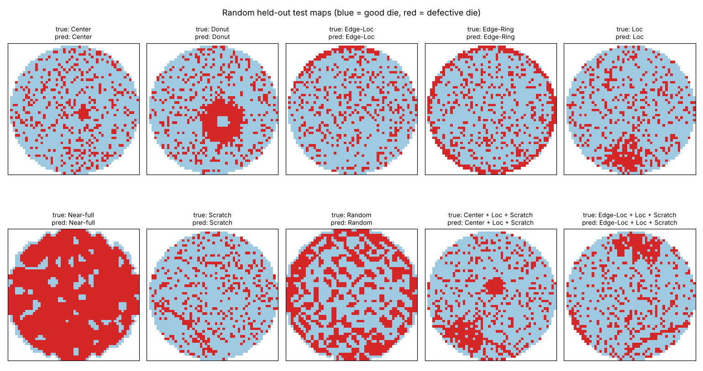

# Wafer-Map Defect-Pattern Classification (MixedWM38)

Which defect patterns appear on a wafer map? Each 52 x 52 map from electrical die tests can show
none, one, or up to four of 8 spatial patterns (Center, Donut, Edge-Loc, Edge-Ring, Loc, Near-full,
Scratch, Random). Recognising the pattern points engineers to its likely process cause. This project
trains a multi-label PyTorch CNN on the public MixedWM38 benchmark and compares it with logistic
regression and a no-skill baseline.

**Result:** on 5,701 held-out test maps, the CNN reaches **macro F1 0.971 (95% CI 0.953 to 0.985)**
and gets all 8 labels right on **96.0%** of maps, versus macro F1 0.760 and 38.5% for logistic
regression on the same pixels.



*Ten test maps drawn at random (`scripts/figure.py`, seed 0, one per pattern plus two mixed types),
not picked for correctness; the CNN labels all ten correctly. Overall test exact match is 96.0%.*

## Use the trained model

```python
import numpy as np, sys; sys.path.insert(0, "src")
from model import PATTERNS, predict_proba

maps = np.load("my_maps.npy")          # (N, 52, 52): 0 off-wafer, 1 good die, 2 defective die
probs = predict_proba(maps)            # (N, 8) probability per pattern; >= 0.5 means present
```

Or from the shell: `python src/predict.py my_maps.npy` prints the patterns found on each map. Weights
(2.7 MB) are in `results/cnn_state.pt`; a test checks they reproduce the reported test score exactly.

## Leakage check: duplicate maps

MixedWM38 contains 1,023 groups of byte-identical maps (2,047 maps). A random 70/15/15 split ignores
this and leaves **209 test maps with an exact copy in training**, so the model is partly graded on
maps it has memorized. This repo splits by unique map, so every copy lands in the same set and no test
map is seen in training (asserted in `src/data.py` and in the tests). Results from random splits on
this dataset should be read with that in mind.

## Design (fixed before training: [`PLAN.md`](PLAN.md), committed first)

| Step | Choice |
|---|---|
| Data | 38,015 maps, 8 binary labels, 38 label combinations ([`data/raw/SOURCE.md`](data/raw/SOURCE.md)) |
| Cleaning | 214 pixels coded 3 (undocumented) recoded as defective die |
| Split | 70 / 15 / 15 by unique map, stratified by label combination, seed 42; train 26,613, validation 5,701, test 5,701 |
| Duplicates | 1,023 groups of byte-identical maps kept in one split. A naive random split would have left **209 test maps with an identical twin in training**, inflating scores |
| B0 | No skill: predicts every pattern absent (each is under 50% prevalent) |
| B1 | Logistic regression per pattern on the 2,704 flattened pixels |
| M1 | CNN: one-hot input (off-wafer / good / defective), 3 conv blocks (32/64/128), dropout 0.3, 8 sigmoid outputs, BCE loss, Adam 1e-3, early stopping on validation macro F1 |
| Threshold | 0.5 for every pattern, not tuned |
| Test set | Scored once, after all choices were fixed |

## Results (`results/metrics.json`)

| Model | Test macro F1 | Exact match (all 8 labels) |
|---|---|---|
| B0 no skill | 0.000 | 2.6% |
| B1 logistic regression | 0.760 | 38.5% |
| **M1 CNN** | **0.971** [0.953, 0.985] | **96.0%** [95.4%, 96.4%] |

Brackets: 95% bootstrap intervals, 1,000 resamples of test maps.

Per pattern (test F1):

| Pattern | Test maps with it | Logistic | CNN | CNN precision | CNN recall |
|---|---|---|---|---|---|
| Center | 1,950 | 0.867 | 1.000 | 1.000 | 1.000 |
| Donut | 1,800 | 0.895 | 1.000 | 1.000 | 1.000 |
| Edge-Loc | 1,950 | 0.231 | 0.980 | 0.995 | 0.965 |
| Edge-Ring | 1,800 | 0.921 | 0.988 | 0.978 | 0.999 |
| Loc | 2,700 | 0.886 | 0.988 | 0.998 | 0.977 |
| Near-full | 22 | 0.553 | 0.864 | 0.864 | 0.864 |
| Scratch | 2,850 | 0.833 | 0.986 | 0.990 | 0.982 |
| Random | 129 | 0.896 | 0.965 | 0.976 | 0.953 |

The largest gain is Edge-Loc (0.23 to 0.98): a local cluster at the wafer edge is defined by position
and shape together, which a per-pixel linear model cannot express. Training stopped at epoch 8; the
best validation macro F1 (0.988) came at epoch 4 (`results/train_log.txt`).

## Limitations

- **Part of MixedWM38 is synthetic.** The dataset description says a GAN generated some maps to
  balance classes, without saying which. These scores describe this benchmark, not raw fab data.
- **Rare patterns have few test maps.** Near-full appears on 22 test maps (149 in the whole dataset),
  so its F1 of 0.864 is uncertain; Random has 129.
- **One data copy.** The original host was unreachable; the file comes from a single GitHub mirror
  and was checked against the published counts, not against a second copy.
- **One seed, one architecture.** No hyperparameter search was run, so the CNN result is a single
  pre-specified configuration rather than a tuned best.

## Run

```
pip install -r requirements.txt
unzip data/raw/Wafer_Map_Datasets.zip -d data/raw   # 394 MB .npz, gitignored
python src/train.py                                 # ~8 min on a 2-core CPU; writes results/
python scripts/figure.py                            # results/examples.png
python -m pytest tests -q                           # checksums, counts, split, weights reproduce score
```

Python 3.13, PyTorch 2.15 (CPU), scikit-learn 1.9.1, NumPy 2.5.3. `results/cnn_state.pt` holds the
trained weights.

MIT License (code). MixedWM38 is a third-party dataset; cite Wang et al. (2020) when using it.
